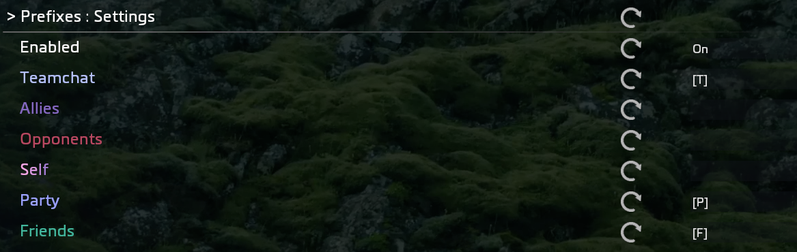
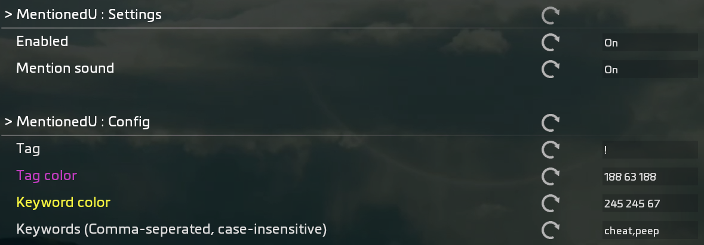

# ccmu

Extensive chat customization mod with many easily usable settings  

## Features

- Easy to use modsettings with color previews
- Color randomization with a single button
- Customizable chat colors
  - Rainbow support: `rgb`
  - Fade support: `f255 255 255,0 0 0`
- Customizable prefixes
- Keyword highlighter with an optional sound notification
- Toggleable network tags
- Animated chat display with controllable speed and optional "typing sounds"

## Color customization

Format has to be as following, **with color channels being an integer ranging from 0-255**:  

- `<R> <G> <B>` for single static colors
- `rgb` for a rainbow fade
- `f<R1> <G1> <B1>,<R2> <G2> <B2>` for fades starting at RGB1 and ending in RGB2

Available fields to customize include:

- Network tag
- Playername
- Seperator
- Message

## Custom prefixes and network tags

This is a really straightforward feature that shouldnt require any further explanation  
> Set custom prefixes

> Hide network tags or disable them all at once  

## MentionedU

Feature to highlight set keywords with a rather odd name  
Allows for a custom sound that plays once a keyword has been mentioned  
with the default being the old *"You got mail!"* TTS voice only millenials remember  
> Keywords are a single comma-seperated and case-insensitive ConVar string

## Custom mention sounds

To use other sounds besides the default *"You got mail!"* TTS voice you have to convert a file into the `.bik` format so that the game can actually play it.  

> A guide on creating `.bik` files can be found on the [official northstar docs](https://docs.northstar.tf/Modding/guides/tools/BIKVideoModding/)

1. Download the sound

2. [Download the RADVideo tool](https://www.radgametools.com/bnkdown.htm) to convert your file into a usable `.bik` file

3. Open your file on RADVideo and select *"Bink it!"*  
   **Make sure to select bink1 as file format at the top of the newly created window**  
   Your converted `.bik` file should now be located in the same directory your original file was in

4. Rename the `.bik` file into `mentionsound.bik` and put it in this mods media folder

## Animated chat and "typing sounds"

Writes each character into the chat one by one to make the messages appear "animated"  
Customizable writing speed *(lower float -> faster messages)*  

Also features "typing sounds" as the message gets written procedually  
Due to `.gif` restrictions I cannot showcase them in this `README`  

The process of making custom "typing sounds" is similar to how you would make custom mention sounds, with the exception being that you would have to manually add or change lines in the `.nut` files to accomodate for the new sounds.  
You should be able to figure it out how to do it yourself by looking at how Ive implemented the already prepackaged sounds.  

## Dependencies  

Because this mod requires some functions that I cannot bother to isolate (especially the ones that run on the UI VM), you will need to download the tools found in [this repo](https://github.com/drachenfruchl/tools) if you havent already!

## Disclaimer

**Regarding Ion client users (like myself):**  
Due to the clients custom modsetting design, many, if not all color previews, show up as plain text (e.g: `^FFFFFF00`).  
Ive uploaded a simple guide on how to replace your files to get back the old Vanilla+ settings [here](https://gist.github.com/drachenfruchl/0fc3e2ac6ac7ba2b96a4c5452661c431)!

**Users that are still on Vanilla+ do **not** have to worry about any of this**
